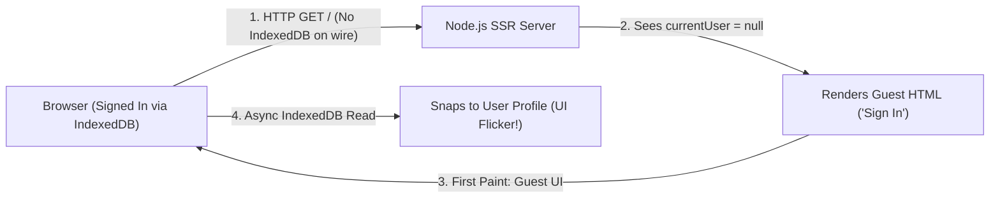
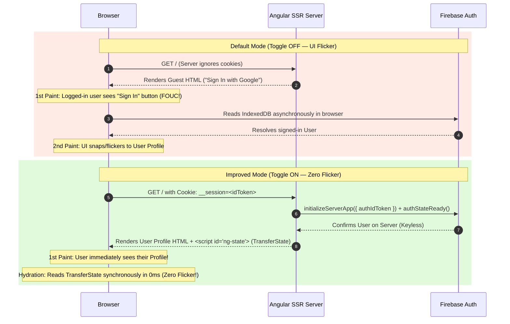
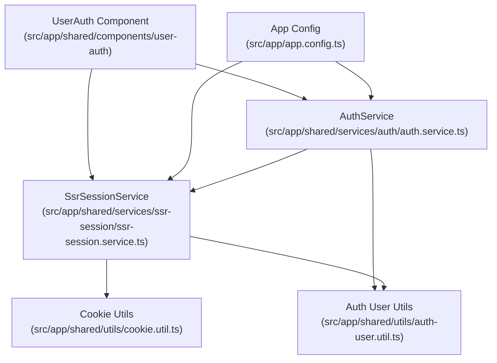

# Solving the SSR Auth & Hydration Dilemma: Angular SSR on Firebase App Hosting

Companion repository for the talk **"Solving the SSR Auth & Hydration Dilemma: Angular SSR on Firebase App Hosting"**.

- 📊 **Presentation Slides**: [Google Slides Deck](https://docs.google.com/presentation/d/1WF3i903NUQNx6gaKsRcrlWXBhimvnUYquPc7kniXffY/edit)

---

## Overview

Static public pages are easy to render on a server—every visitor receives the same HTML. Dynamic, authenticated user dashboards are where Server-Side Rendering (SSR) gets tricky.

Out of the box, combining **Angular SSR** with **Firebase Authentication** produces the dreaded **Flash of Unauthenticated Content (FOUC)**: when a signed-in user refreshes the page, the server briefly renders the unauthenticated *"Sign In"* screen before client-side JavaScript boots and snaps to the user's profile.

This project demonstrates **why** that flicker happens and lets you interactively toggle between:
1. **Default Mode (Client-Only Auth)** — demonstrates the SSR unauthenticated flash on page refresh.
2. **Improved Mode (SSR Cookie + `FirebaseServerApp` + `TransferState`)** — eliminates UI flicker and double data-fetching without requiring privileged `firebase-admin` service account keys.

---

## Why Does Naive SSR Flicker?

By default, the Firebase JS SDK persists the user's authentication session in **browser `IndexedDB`**.



1. **The Server Blind Spot**: `IndexedDB` lives strictly inside the browser tab and is never sent with an HTTP `GET` request.
2. **Wrong First Paint**: When the Node SSR server renders the route, Firebase sees `currentUser = null` and sends back the unauthenticated **Guest ("Sign In with Google")** HTML.
3. **The Hydration Gap**: Even if the server renders the user, when Angular boots in the browser, `IndexedDB` takes ~200–500ms to open asynchronously—causing the client to momentarily reset or flicker unless bridged via `TransferState`.

---

## End-to-End Request Lifecycle: Default vs. Improved



---

## Architecture & File Map

To keep [`AuthService`](src/app/shared/services/auth/auth.service.ts) lean and focused strictly on Firebase Authentication, cross-boundary concerns (cookies, `REQUEST` inspection, and `TransferState`) are isolated in [`SsrSessionService`](src/app/shared/services/ssr-session/ssr-session.service.ts) and pure utility functions.



| File | Responsibility |
| :--- | :--- |
| [`src/app/app.routes.server.ts`](src/app/app.routes.server.ts) | Configures `RenderMode.Server` so routes render dynamically per request instead of static build-time prerendering. |
| [`src/app/app.config.ts`](src/app/app.config.ts) | Branches Firebase setup between `initializeApp` (browser) and `initializeServerApp` (server), and registers `provideAppInitializer`. |
| [`src/app/shared/services/auth/auth.service.ts`](src/app/shared/services/auth/auth.service.ts) | Lean Firebase Authentication service handling `resolveServerAuth()`, `initAuthState()`, Google sign-in, and sign-out. |
| [`src/app/shared/services/ssr-session/ssr-session.service.ts`](src/app/shared/services/ssr-session/ssr-session.service.ts) | Reads server `REQUEST` cookies, syncs the browser `__session` cookie, manages `TransferState`, and controls the live demo toggle. |
| [`src/app/shared/utils/cookie.util.ts`](src/app/shared/utils/cookie.util.ts) | Cookie constants (`__session`, `ssr_fix`) and helpers for parsing, setting, and clearing cookies. |
| [`src/app/shared/utils/auth-user.util.ts`](src/app/shared/utils/auth-user.util.ts) | Maps complex Firebase `User` objects into plain JSON (`SerializableUser`) for safe `TransferState` serialization. |
| [`src/app/shared/components/user-auth/`](src/app/shared/components/user-auth/user-auth.ts) | Neo-brutalist UI component featuring the **Avoid SSR Auth Flicker** toggle switch, telemetry badge, and **Reload Page** trigger. |
| [`angular.json`](angular.json) | Configures SSR build options and `security.allowedHosts` (`localhost`, `*.hosted.app`, `*.web.app`). |

---

## The 4 Pillars of the Implementation

### 1. Dynamic Per-Request Server Rendering
**File:** [`src/app/app.routes.server.ts`](src/app/app.routes.server.ts)

By default, Angular CLI configures SSR routes with `RenderMode.Prerender`, which generates static HTML once at `ng build` time when no user exists. Authenticated pages must use `RenderMode.Server` so the Node server executes per request and can inspect the user's cookies:

```ts
export const serverRoutes: ServerRoute[] = [
  {
    path: '**',
    renderMode: RenderMode.Server,
  },
];
```

### 2. Crossing the Client–Server Boundary with the `__session` Cookie
**Files:** [`src/app/shared/utils/cookie.util.ts`](src/app/shared/utils/cookie.util.ts) & [`src/app/shared/services/ssr-session/ssr-session.service.ts`](src/app/shared/services/ssr-session/ssr-session.service.ts)

- **Why `__session`?**: Firebase App Hosting and Firebase Hosting CDN strip all cookies from incoming HTTP requests **except** `__session` (to maximize CDN cache hits). Naming the cookie `__session` ensures it reaches your SSR backend in production.
- **Why `onIdTokenChanged`?**: Firebase ID tokens expire every 60 minutes. Listening to `onIdTokenChanged` in [`AuthService.initAuthState()`](src/app/shared/services/auth/auth.service.ts) updates the `__session` cookie on sign-in, sign-out, **and** silent background token refreshes.

### 3. Keyless Server Auth with `FirebaseServerApp`
**File:** [`src/app/app.config.ts`](src/app/app.config.ts)

Instead of using `firebase-admin` (which requires managing privileged service account keys and bypasses Firestore Security Rules), the server uses `initializeServerApp` from the standard Firebase JS SDK with the user's `authIdToken`:

```ts
provideFirebaseApp((injector: Injector) => {
  const ssrSession = injector.get(SsrSessionService);

  if (ssrSession.isBrowser) {
    return initializeApp(environment.firebaseConfig);
  }

  const authIdToken = ssrSession.ssrFixEnabled()
    ? ssrSession.getServerSessionToken()
    : undefined;

  return initializeServerApp(
    environment.firebaseConfig,
    authIdToken ? { authIdToken } : {},
  );
}),
provideAuth((injector: Injector) => getAuth(injector.get(FirebaseApp))),
provideAppInitializer(() => inject(AuthService).resolveServerAuth()),
```

> **Note:**
> - Passing `injector.get(FirebaseApp)` into `getAuth()` is required so `@angular/fire/auth` resolves the `FirebaseServerApp` instance on the server.
> - `provideAppInitializer()` ensures Angular SSR waits for `resolveServerAuth()` to complete before serializing the HTML response and `TransferState`.

### 4. Zero-Flicker Hydration with `TransferState`
**Files:** [`src/app/shared/services/ssr-session/ssr-session.service.ts`](src/app/shared/services/ssr-session/ssr-session.service.ts) & [`src/app/shared/services/auth/auth.service.ts`](src/app/shared/services/auth/auth.service.ts)

1. **On the Server**: [`AuthService.resolveServerAuth()`](src/app/shared/services/auth/auth.service.ts) awaits `this.auth.authStateReady()`, maps the user to a plain JSON [`SerializableUser`](src/app/shared/utils/auth-user.util.ts) (`{ uid, displayName, email, photoURL }`), sets the component signals for the SSR render, and stores the object in Angular's `TransferState`.
2. **In the Browser**: [`AuthService.initAuthState()`](src/app/shared/services/auth/auth.service.ts) synchronously reads `TransferState` inside the constructor before `IndexedDB` opens. The client hydrates with `isAuthenticated() === true` on Frame 1, matching the server HTML without any UI flicker.

---

## Running & Testing the Demo Locally

### 1. Install Dependencies & Start the Server

```bash
npm install
npm start
```

Open `http://localhost:4200/` in your browser (or run a full production SSR build with `npm run build && npm run serve:ssr:ssr-demo` on `http://localhost:4000/`).

### 2. Walkthrough: Default Mode vs. Improved Mode

1. **Sign In**: Click **Sign In with Google** and complete the Google popup flow.
2. **Test Default Mode (Flicker)**:
   - Leave the **Avoid SSR Auth Flicker** toggle **OFF** (`Default Mode`).
   - Click **Reload Page to Test SSR** (or press `Cmd+R`).
   - **Observe**: The server renders the unauthenticated *"Sign In with Google"* panel first, and then snaps to your profile once client-side Firebase finishes reading `IndexedDB`.
3. **Test Improved Mode (Zero Flicker)**:
   - Flip the **Avoid SSR Auth Flicker** toggle **ON** (`Improved Mode`).
   - Click **Reload Page to Test SSR** (or press `Cmd+R`).
   - **Observe**: The server reads the `__session` cookie, renders your avatar and display name directly in the initial HTML, and hydrates synchronously via `TransferState` with **zero flicker**.

---

## Deploying to Firebase App Hosting

1. **SSRF Host Protection (`angular.json`)**:
   Angular 22+ blocks unrecognized `Host` headers by default to prevent SSRF attacks. [`angular.json`](angular.json) is pre-configured to allow `localhost` as well as Firebase App Hosting domains (`*.hosted.app` and `*.web.app`):
   ```json
   "security": {
     "allowedHosts": ["localhost", "127.0.0.1", "*.hosted.app", "*.web.app"]
   }
   ```
2. **Deploy**:
   ```bash
   firebase init apphosting
   ```
